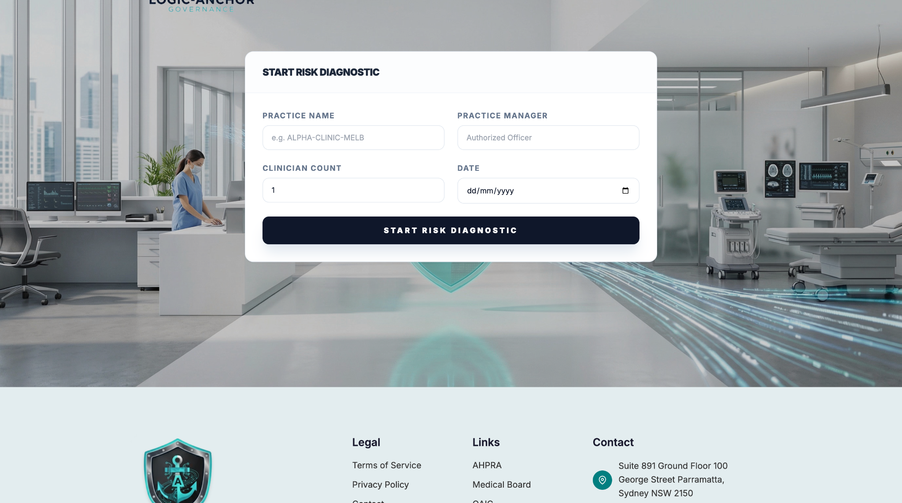
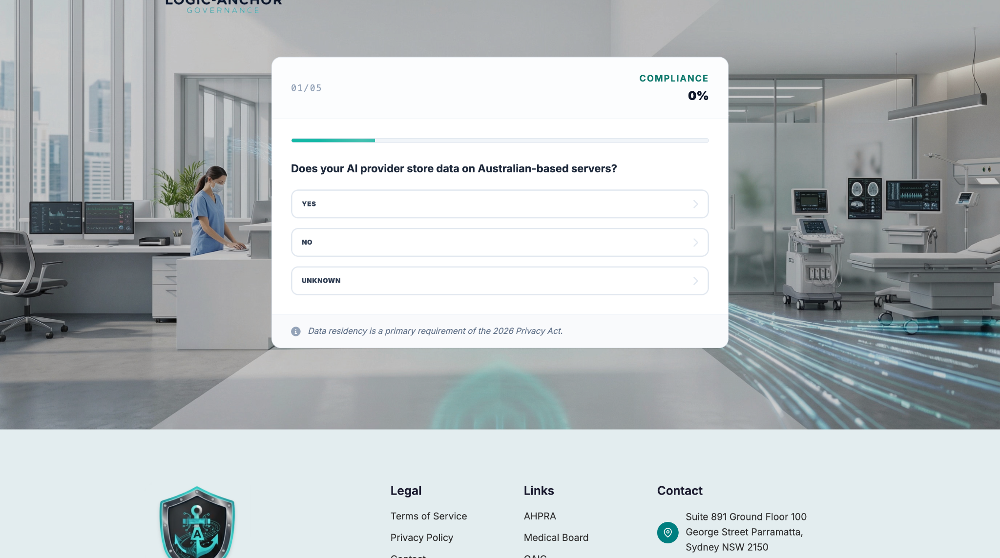
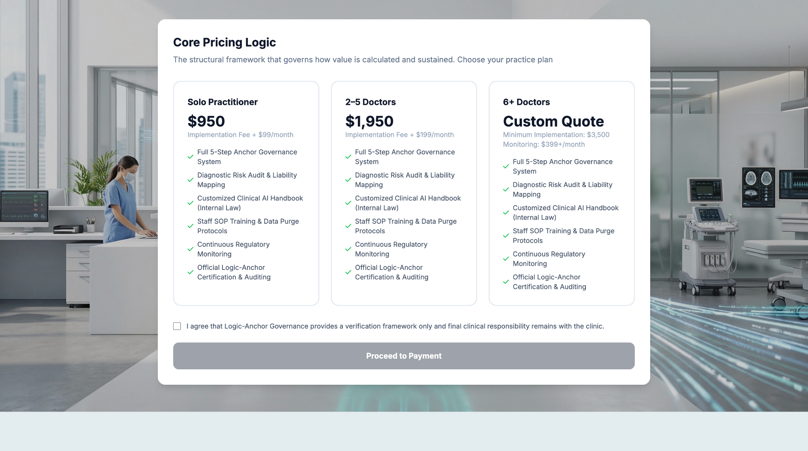
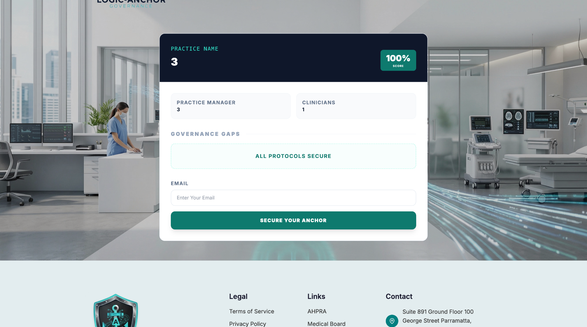

# Logic-Anchor Governance

Logic-Anchor Governance is a clinical AI governance and risk-mitigation platform concept designed to guide healthcare practices through a structured governance diagnostic, review compliance-related questions, view a governance result summary and explore service plans.

> **Important notice:** Logic-Anchor Governance provides framework validation and risk mitigation protocols. We are not a law firm. This diagnostic is for governance purposes only and does not constitute legal advice.

---

## Project Overview

The platform presents a guided workflow for a healthcare practice to start a governance risk diagnostic, provide practice details, answer a structured questionnaire and review a governance summary. The interface also presents service pricing options for different practice sizes.

## Frontend Features

- Clinical AI governance-focused landing and diagnostic experience.
- Practice registration form with practice name, practice manager, clinician count and date.
- Guided multi-step risk / compliance questionnaire.
- Yes, No and Unknown response options for diagnostic questions.
- Step progress indicator and compliance percentage display.
- Governance result summary with practice details and score.
- Governance gaps / protocol status section.
- Email capture step with a “Secure Your Anchor” call to action.
- Pricing comparison for solo practitioners, small practices and larger practices.
- Responsive interface with a consistent clinical governance visual style.
- Footer links for legal information, external regulatory resources and contact details.

## Governance Diagnostic Workflow

1. **Start diagnostic:** Enter the practice name, authorised practice manager, clinician count and assessment date.
2. **Complete assessment:** Work through the questionnaire and choose the most appropriate response for each question.
3. **Review progress:** Follow the step counter and displayed compliance percentage.
4. **View summary:** Review the practice information, governance score and protocol status shown by the application.
5. **Continue securely:** Provide an email address through the secure-anchor step where required.
6. **Review plan options:** Compare the available service tiers and acknowledge the stated governance responsibility before proceeding.

## Backend / Application Workflow

The product workflow represented by the interface can be organised around the following application modules:

| Module | Purpose |
|---|---|
| Practice records | Capture and maintain practice name, practice manager and clinician count |
| Diagnostic sessions | Start and manage an assessment for a practice |
| Questionnaire | Deliver diagnostic questions and record Yes / No / Unknown answers |
| Assessment progress | Track the current step and completion progress |
| Governance results | Present the assessment score, protocol status and identified governance gaps |
| Email capture | Collect the email address associated with the secure-anchor step |
| Plans and pricing | Display plan tiers and their implementation / monitoring pricing |
| Consent acknowledgement | Record acknowledgement of the governance responsibility statement before payment progression |

*This section describes the workflow and modules represented by the supplied screens. Confirm the exact backend implementation and enabled functionality before treating every item as a completed production feature.*

## Pricing Interface

The supplied pricing screen presents three practice tiers:

- **Solo Practitioner:** displayed implementation fee of $950 plus $99/month.
- **2–5 Doctors:** displayed implementation fee of $1,950 plus $199/month.
- **6+ Doctors:** custom quote, with a displayed minimum implementation of $3,500 and monitoring from $399+/month.

Pricing is shown as it appears in the supplied project screenshots and may be subject to change.

## Screenshots

### Risk diagnostic start

### Compliance questionnaire

### Governance results dashboard

### Secure-anchor email step

### Pricing and plan selection

## Technology Stack

Add the exact technologies and versions used by the implementation before publishing this section. For example, document the actual backend framework, language, database, frontend framework, CSS toolkit, build tooling and any payment or email integrations that are present in the codebase.

Do not list technologies or integrations that are not actually used.

## Local Setup

Setup instructions depend on the actual source code and deployment configuration. Add the verified installation steps for this repository, including:

- Required language and runtime versions.
- Dependency installation commands.
- Environment variable setup using a safe example file.
- Database creation and migration instructions, if applicable.
- Frontend asset installation and build commands.
- Local development server command.

Never include real `.env` values, API keys, passwords or production credentials in this README.

## Repository & Confidentiality

If this is a client project, publish only the code, documentation and screenshots that you are authorised to share.

Do not commit:

- `.env` files, credentials, API keys, access tokens or private certificates.
- Real practice, clinician or patient information.
- Production database exports, backups or logs.
- Proprietary assessment logic, confidential scoring rules or private integrations unless approved for publication.
- Client-owned assets or documents without permission.

A public GitHub repository can be cloned and downloaded. `.gitignore` prevents selected untracked files from being added, but it does not remove files already committed or erase them from Git history. Rotate any exposed credentials and clean repository history before publishing sensitive material.

## Disclaimer

Logic-Anchor Governance provides framework validation and risk mitigation protocols. We are not a law firm. This diagnostic is for governance purposes only and does not constitute legal advice. The screenshots and feature descriptions are for project demonstration purposes and should not be interpreted as a guarantee of regulatory compliance or clinical safety.

## Live Project

- Website: `https://YOUR-LIVE-DOMAIN.com`
- GitHub: `https://github.com/YOUR-USERNAME/YOUR-REPOSITORY`

Replace these placeholders with approved public links before publishing.
